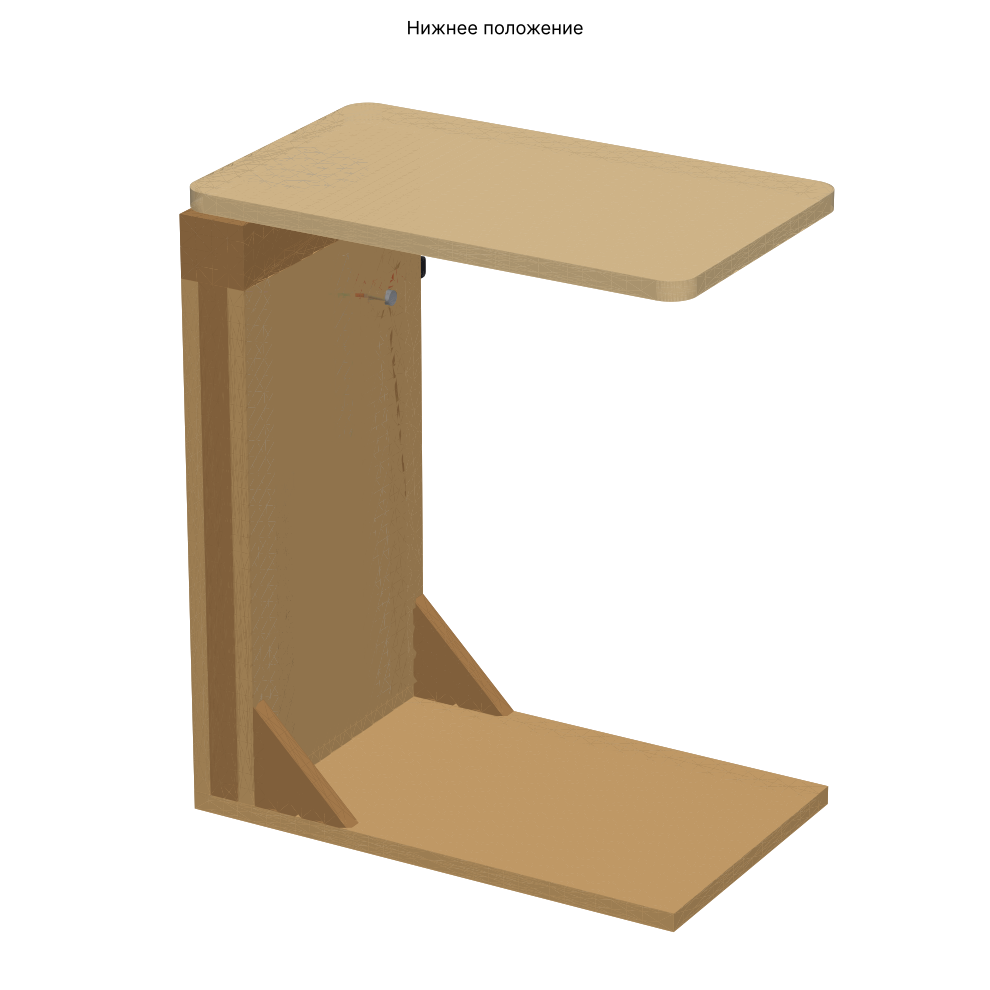
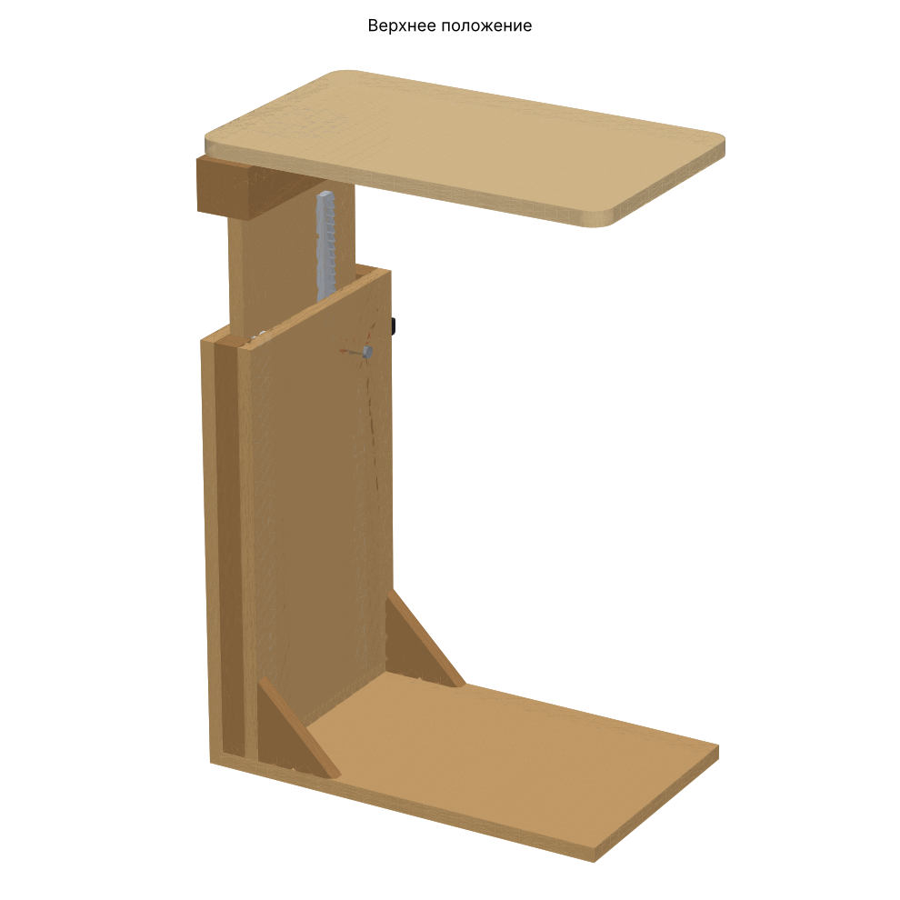
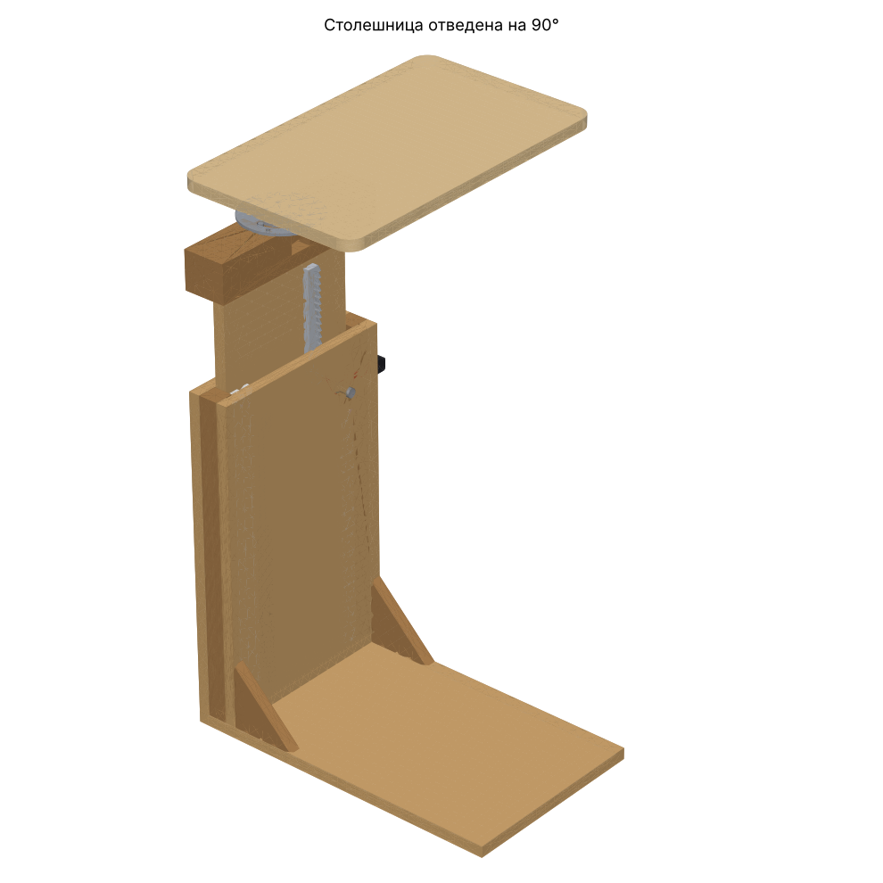
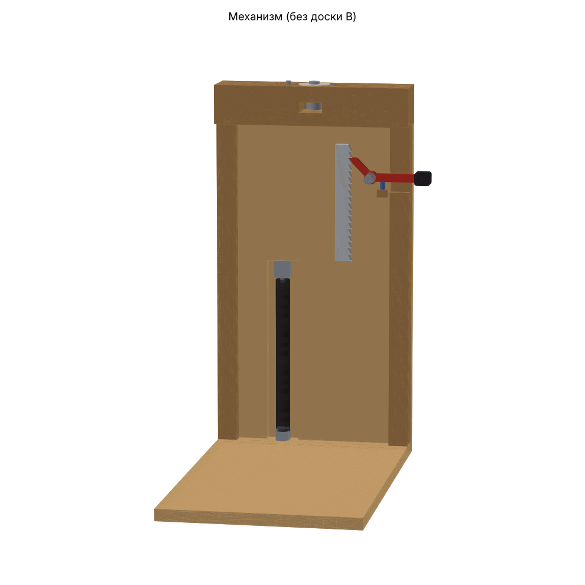
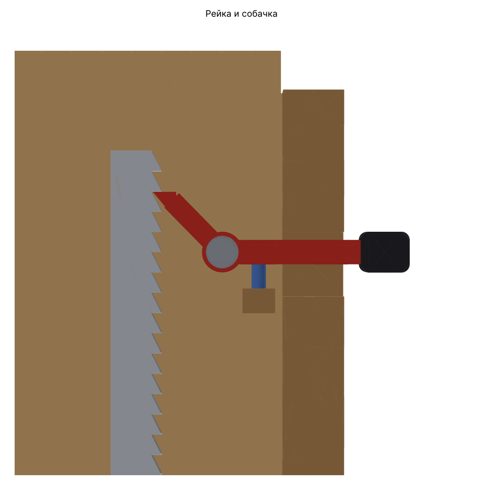

# Диванный столик с подъёмом и поворотом — генератор 3D-модели

Параметрическая модель П-образного столика: основание заходит под диван,
сбоку двойная стойка, сверху столешница. Столешница:

- **поднимается и опускается** храповым механизмом внутри стойки (шаг 10 мм);
- **поворачивается на 90°** вокруг вертикальной оси над стойкой, фиксируется
  шариком в положениях 0° и 90°.



| Верхнее положение | Отведена на 90° | Механизм (без доски B) |
|---|---|---|
|  |  |  |

## Смотреть онлайн (3D, крутится мышью/пальцем)

На [3dviewer.net](https://3dviewer.net), STEP с деревом деталей:

- [Нижнее положение](https://3dviewer.net/#model=https://raw.githubusercontent.com/jurik555/3d_stol_meh/HEAD/models/assembly_low.step)
- [Верхнее положение](https://3dviewer.net/#model=https://raw.githubusercontent.com/jurik555/3d_stol_meh/HEAD/models/assembly_high.step)
- [Верх, столешница отведена на 90°](https://3dviewer.net/#model=https://raw.githubusercontent.com/jurik555/3d_stol_meh/HEAD/models/assembly_high_rotated.step)

Облегчённые GLB: [низ](https://3dviewer.net/#model=https://raw.githubusercontent.com/jurik555/3d_stol_meh/HEAD/models/assembly_low.glb) ·
[верх](https://3dviewer.net/#model=https://raw.githubusercontent.com/jurik555/3d_stol_meh/HEAD/models/assembly_high.glb) · [повёрнута](https://3dviewer.net/#model=https://raw.githubusercontent.com/jurik555/3d_stol_meh/HEAD/models/assembly_high_rotated.glb)

Файлы лежат в `models/` и обновляются Action'ом автоматически после каждого
изменения параметров.

## Как работает механизм



Стойка — это две доски по 18 мм, между ними бруски 30×30, внутри полость 30 мм.

1. **Мачта** (фанера 18 мм) скользит в полости вверх-вниз по направляющим
   из PTFE. Сверху на неё надет поворотный блок со столешницей.
2. На лицевой стороне мачты привинчена **зубчатая рейка** с пилообразными зубьями.
3. На доске B на оси M8 висит **собачка**. Пружина прижимает её зуб под
   ровную грань зуба рейки. Чем сильнее давят на стол сверху, тем глубже
   собачка заходит в зацепление (самозатягивание).
4. Хвост собачки выходит через паз в боковом бруске: это **рычаг**.
   - **Вверх:** просто тянуть столешницу, собачка щёлкает по скосам зубьев.
   - **Вниз:** нажать рычаг вниз, собачка выходит из зубьев, опустить стол
     и отпустить рычаг. Стол фиксируется на ближайшем зубе.
5. **Газовый упор** в окне мачты частично компенсирует вес. Его усилие должно
   быть *меньше* веса подвижной части, иначе стол будет подниматься сам.
   Рекомендацию генератор пишет в `BOM.md`.
6. **Поворот:** болт M16 во втулке, фланец Ø120 под столешницей, шайба PTFE,
   шариковый фиксатор M8 (защёлкивается на 0° и 90°) и штифт в дуговом
   пазу фланца, который ограничивает угол.

## Что генерируется

| Папка | Содержимое |
|---|---|
| `step/` | Сборки `assembly_low/high/high_rotated.step`, открываются во Fusion 360, FreeCAD, Компас |
| `glb/` | Те же сборки в GLB: смотреть в браузере (например, gltf-viewer.donmccurdy.com) или на телефоне |
| `stl/` | Каждая деталь отдельно, для печати или проверки |
| `dxf/` | Плоские профили для лазерной резки: рейка, собачка, фланец |
| `png/` | Превью |
| `BOM.md` | Спецификация: размеры деталей, массы, крепёж, рекомендуемый газовый упор |

## Запуск через GitHub Actions

- При каждом push изменений в `params.json` или `generate.py` workflow
  **«Генерация 3D-модели»** собирает модель. Файлы лежат в артефакте
  `sofa-table-model` на странице запуска (Actions → запуск → Artifacts).
- Свои размеры без правки файлов: Actions → «Генерация 3D-модели» →
  **Run workflow**, заполнить нужные поля. Пустые поля берутся из `params.json`.
- Спецификация выводится прямо в Summary запуска.

## Локальный запуск

```bash
pip install -r requirements.txt
python generate.py                         # параметры из params.json → ./output
python generate.py --set width=320 --set travel=200
```

## Основные параметры (`params.json`)

| Параметр | По умолчанию | Смысл |
|---|---|---|
| `width` | 300 | ширина основания, стойки и столешницы |
| `board_t` | 18 | толщина фанеры |
| `table_height_min` | 600 | высота верха столешницы в нижнем положении |
| `travel` | 150 | ход подъёма (округляется до шага зуба) |
| `top_length` / `base_length` | 500 / 500 | длина столешницы и основания |
| `tooth_pitch` | 10 | шаг регулировки высоты |
| `rotation_deg` | 90 | угол отвода столешницы |
| `gas_spring_length` / `gas_spring_stroke` | 400 / 150 | газовый упор (ход ≥ хода стола) |
| `gusset` | 100 | косынки между стойкой и основанием, 0 — без них |

Скрипт проверяет параметры и останавливается с понятной ошибкой, если что-то
не помещается (например, газовый упор длиннее стойки).

## Что стоит проверить перед изготовлением

- **Просвет под диваном:** основание 18 мм, косынки 100 мм со стороны дивана.
  Если не пролезают, поставьте `"gusset": 0` и усильте узел стальными уголками.
- **Газовый упор:** подвижная часть весит около 4,5 кг, рекомендуемое усилие
  около 35 Н. Упоров слабее 50 Н почти нет, так что можно обойтись без упора:
  храповик всё равно держит стол.
- **Рейка:** алюминий или сталь 8–10 мм, лазерная резка по `dxf/rack.dxf`.
  Можно напечатать из PETG со 100 % заполнения, но металл надёжнее.
